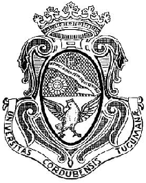
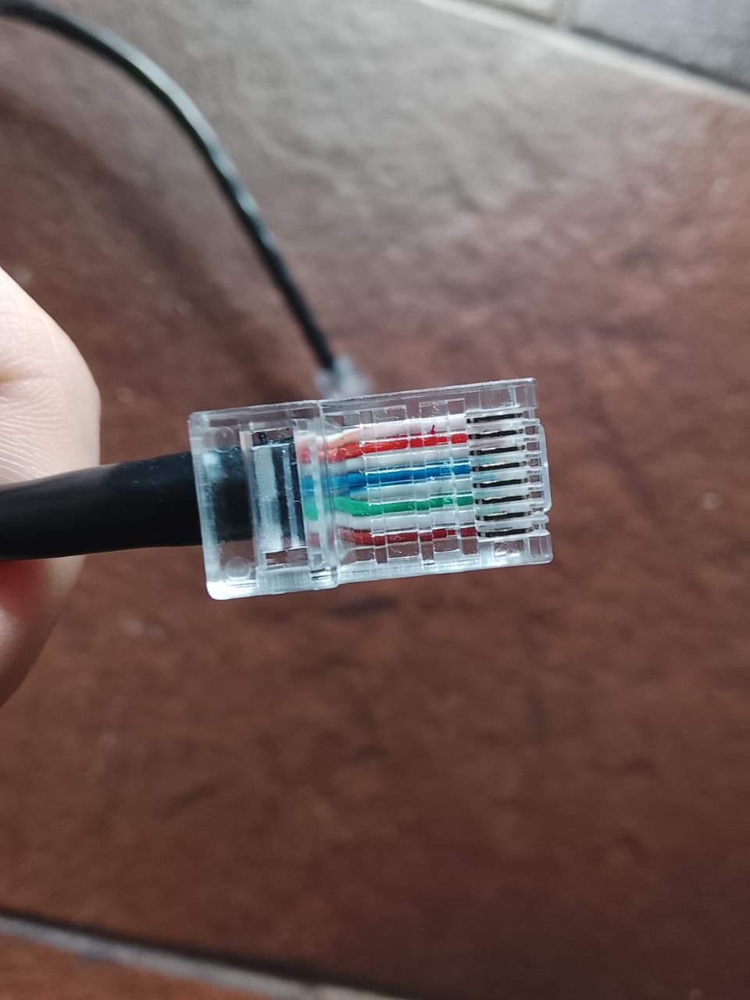
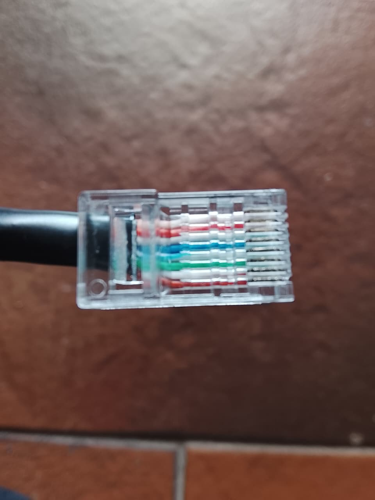
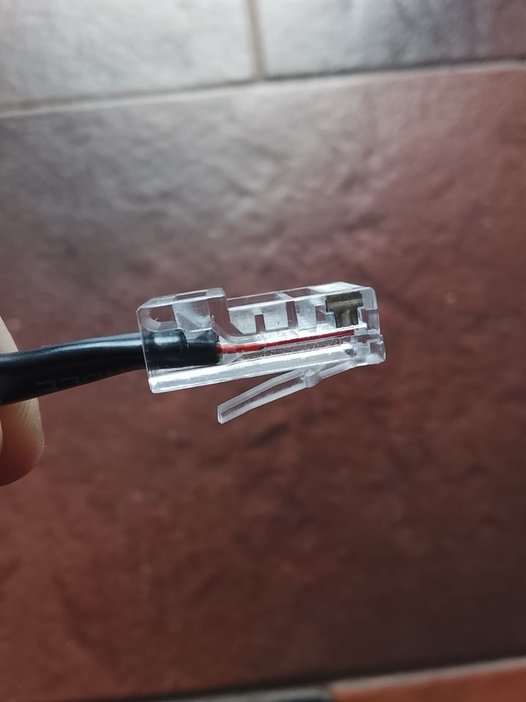
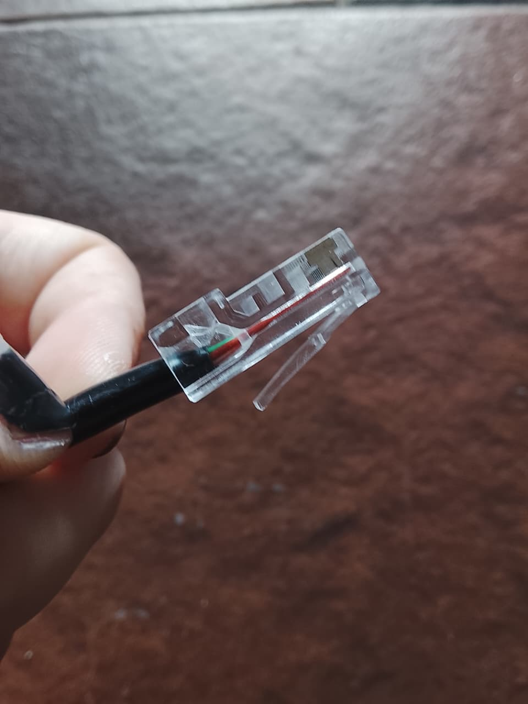
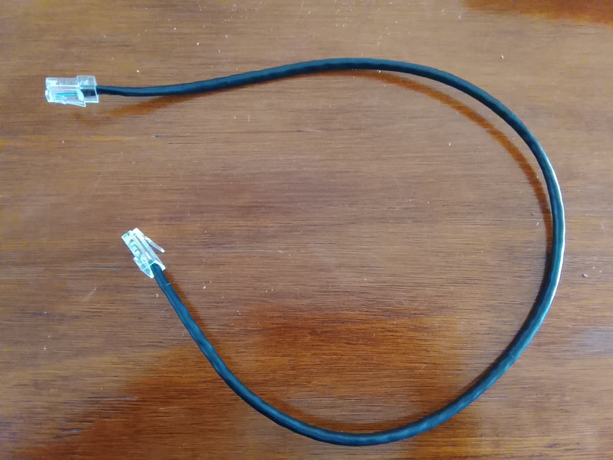
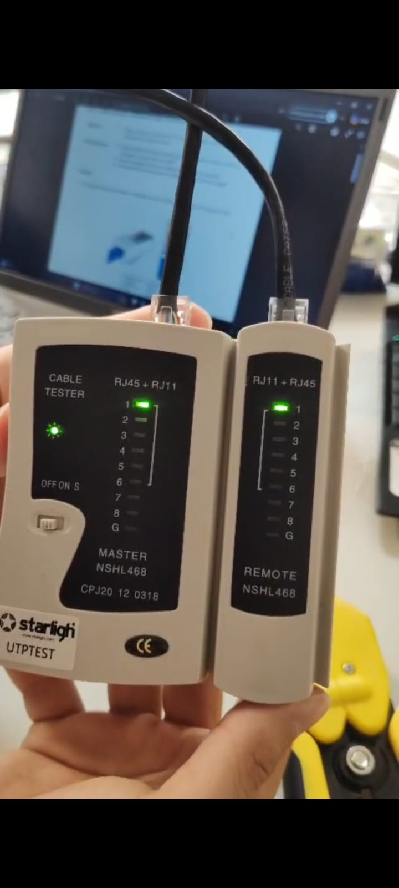
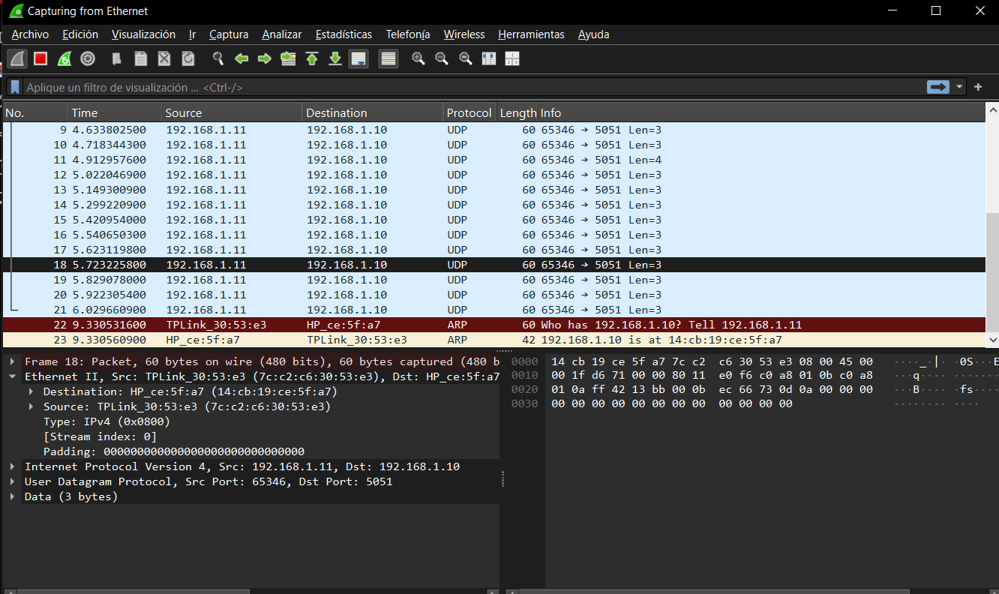
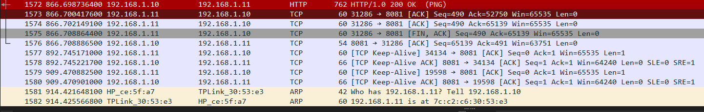

UNIVERSIDAD NACIONAL DE CÓRDOBA

FACULTAD DE CIENCIAS EXACTAS, FÍSICAS, Y NATURALES

CÁTEDRA DE COMPUTACIÓN

**“Trabajo Práctico N°6: Capa Física y de Red”**

Alumnos:  
Eliezer Flores (45172399)  
Genaro Agustín Mateos Ferrero (19103190)    
Victor José Arturo Castro (46522607)  
Tiziano Quevedo (44972730)  
Gonzalo del Cotillo (43216694)  
Mariano Stroppa (46309318)  
Angélica Moisés (46765089)

Comisión: ICOMP24-3 

## Parte 1: Taller de armado y verificación de cables Cat5/Cat5e

### 1.1 Pasos para crimpar un cable bajo la norma T568A/B

Para armar un cable **directo** (*straight-through*) ambos extremos deben terminarse con la **misma norma**. En nuestro caso se utilizó **T568B** en los dos conectores. A modo de referencia, el orden de los conductores (con la traba del conector hacia abajo y los contactos mirando hacia uno, de izquierda a derecha) es:

| Pin | T568A | T568B (utilizada) |
|:---:|:---|:---|
| 1 | Blanco-Verde | Blanco-Naranja |
| 2 | Verde | Naranja |
| 3 | Blanco-Naranja | Blanco-Verde |
| 4 | Azul | Azul |
| 5 | Blanco-Azul | Blanco-Azul |
| 6 | Naranja | Verde |
| 7 | Blanco-Marrón | Blanco-Marrón |
| 8 | Marrón | Marrón |

**Materiales y herramientas:** cable UTP Cat5/Cat5e, dos conectores RJ45 (8P8C), pinza crimpeadora y pelacables, y tester de cables Ethernet.

**Procedimiento:**

1. Cortar el cable dejando un pequeño margen extra por si hay que rehacer alguna punta.
2. Retirar la cubierta exterior unos 2 a 3 cm desde el extremo, girando el pelacables con cuidado para no cortar ni dañar los cables internos.
3. Destrenzar los pares solo lo necesario y enderezar cada conductor para que queden rectos.
4. Ordenar los conductores según la norma elegida (T568B)
5. Recortar las puntas en forma recta y pareja
6. Insertar los conductores en el RJ45 con la traba hacia abajo, empujando hasta que todos lleguen al fondo del conector, cada uno en su canal. La cubierta exterior debe quedar por dentro, debajo de la pestaña de sujeción.
7. Verificar visualmente, antes de crimpar, que el orden de colores sea el correcto y que ningún conductor haya quedado corto o se haya cruzado de canal.
8. Crimpar colocando el conector en la crimpeadora y apretando hasta el final del recorrido. Así las cuchillas doradas perforan el aislamiento de cada conductor y la pestaña trasera presiona la cubierta, fijando el cable.
9. Repetir los pasos 2 a 8 en el otro extremo con la misma norma (T568B), ya que si se usara T568A en un extremo y T568B en el otro se obtendría un cable cruzado.
10. Probar el cable con el tester para confirmar la continuidad y el orden correcto de los 8 pines.

### 1.2 Inspección visual y constructiva

Cabe destacar que durante el armado del cable tuvimos ciertas complicaciones que nos atrasaron, lograr que los ocho conductores mantuvieran el orden y quedaran alineados al introducirlos en el conector nos resultó complicado y requirió algunos intentos. De todas formas, el resultado final fue satisfactorio, tal como se observa en las fotografías y como se confirmó luego con el tester. Por otro lado, debido a las demoras ocasionadas por estas dificultades, no llegamos a poder comparar nuestro cable con el de algún otro grupo, por lo que el análisis se limita a la inspección de nuestro propio trabajo.

* **Aspectos positivos:**
  * El orden de los colores es correcto y respeta la norma T568B en ambos extremos lo que lo convierte en un cable directo.
  * Los conductores llegan hasta el fondo del conecto: en la vista frontal y en la vista lateral se ve que las puntas alcanzan la zona de los contactos dorados, por lo que las cuchillas perforan correctamente cada conductor.
  * En los extremos la cubierta exterior quedó dentro del conector aportando resistencia ante tirones.
  * El crimpado quedó bien, los contactos están hundidos de manera uniforme y el cable no se suelta al tirar suavemente.

* **Aspectos negativos**
  * Los conductores entran al conector en un leve abanico en lugar de completamente paralelos, lo que indica que podrían haberse alineado mejor antes de insertarlos.
  * Al habernos topado con problemas, tuvimos que re-hacer más de una vez las puntas después del crimpado, lo cual implica recortar el cable. Esto lo deja con un tamaño desfavorable para conexiones con un switch más lejano. Si bien no nos dificultó el procedimiento de este laboratorio, debería ser tomado en cuenta como crítica.

* **Justificación fotográfica:**

  
  *Figura 1: Vista frontal de un extremo, donde se aprecia el orden de colores T568B y los conductores llegando al fondo.*

  
  *Figura 2: Vista frontal del otro extremo, con el mismo orden de colores (cable directo).*

  
  *Figura 3: Vista lateral. La cubierta exterior queda dentro del conector, bajo la pestaña de sujeción, y los conductores llegan hasta los contactos.*

  
  *Figura 4: Vista lateral del otro extremo. La cubierta queda justo en el límite de la pestaña y se ven conductores sin vaina y marcas en el plástico.*

  
  *Figura 5: Cable terminado, con ambos conectores RJ45 crimpados.*

### 1.3 Verificación eléctrica

Para la verificación se utilizó un tester de cables Ethernet. Se conectó un extremo del cable a cada módulo y se encendió el tester en modo de barrido. El equipo envía una señal pin por pin y enciende el LED correspondiente en ambos módulos.

Resultado: los LEDs se encendieron de forma secuencial del 1 al 8 y simultáneamente en el mismo número en el Master y en el Remote. Esto confirma que:

* Hay continuidad en los 8 conductores
* No existen cruces ni cortocircuitos entre pares
* El cable es directo, ya que la correspondencia de pines es 1 a 1.

El LED G (tierra) no se encendió, lo cual es normal porque el cable utilizado es UTP. En resumen, a pesar de las complicaciones en el armado, el cable superó la prueba eléctrica correctamente.

* **Evidencia fotográfica:**

  
  *Figura 6: Tester con el cable conectado se observa el LED 1 encendido en simultáneo en ambos módulos durante el barrido.*

---

## Parte 2: Equipamiento físico y generación de tráfico

### 2.1 Levantar y testear una LAN

#### Justificación de Direccionamiento IP (Punto 1.d)

* **IPv4 configurada:** 192.168.1.10 y 192.168.1.11

Se optó las direcciones IP correspondientes al espacio de direccionamiento privado establecido por el estándar RFC 1918. Estas direcciones pertenecen a un bloque comúnmente utilizado para redes de área local (LAN) por lo que garantiza que no existan conflictos con direcciones IP públicas.

* **Máscara de subred:** 255.255.255.0

La configuración de esta máscara indica que los primeros tres octetos corresponden a la porción de red y el último octeto a la porción de host. Al aplicar esta misma máscara en ambas computadoras, las dos direcciones IP quedan lógicamente ubicadas dentro de la misma subred. Esto es fundamental porque le indica a la pila TCP/IP de cada computadora que el equipo de destino se encuentra en el mismo segmento de red local. Como resultado, las computadoras pueden comunicarse directamente en la capa de enlace de datos (Capa 2) resolviendo sus direcciones MAC mediante el protocolo ARP a través del switch, sin requerir un enrutador el cual no se disponía en el laboratorio.

* **Default Gateway:** Ninguna

Se decidió no configurar ninguna puerta de enlace predeterminada ya que solo se utiliza cuando un host necesita enviar paquetes a una dirección IP que se encuentra fuera de su propia subred. Dado que el alcance de esta actividad consistía en comunicar únicamente a dos equipos conectados físicamente al mismo switch en una LAN aislada, todo el tráfico generado tenía un destino estrictamente local. En pocas palabras, configurar un gateway hubiera sido redundante e innecesario para los fines de este laboratorio.

#### Captura de Tráfico UDP (Punto 4)

* **Captura en Wireshark:**  
* **Análisis de la captura:** *Documentar los detalles observados (direcciones IP de origen y destino, puertos utilizados, longitud, etc.).*

#### Cuestionario sobre UDP (Punto 5)

* **a) ¿Se observa algún procedimiento de establecimiento de conexión antes de enviar los datos?**

* **b) ¿Existe algún mecanismo de confirmación de recepción equivalente a los ACK de TCP?**

* **c) ¿Qué ocurre si se envían mensajes mientras el receptor UDP no está ejecutándose?**

* **d) ¿UDP garantiza que los mensajes lleguen en el mismo orden en que fueron enviados?**

* **e) ¿Qué aplicaciones reales utilizan UDP y por qué?**

---

## Parte 3: Desarrollar un pequeño servidor

### 3.1 Análisis de tráfico web (Punto 4)

* **Captura en Wireshark (Descarga HTTP/curl):** 

* **Tipo de tráfico observado:** *[Explicar qué protocolo de la capa de transporte (TCP) se está utilizando para esta transmisión, identificando el Three-Way Handshake, ACKs, etc., y comparándolo con el comportamiento visto anteriormente en UDP].*
