UNIVERSIDAD NACIONAL DE CÓRDOBA

FACULTAD DE CIENCIAS EXACTAS, FÍSICAS, Y NATURALES

CÁTEDRA DE COMPUTACIÓN

**“Trabajo Práctico N°7: Detección y corrección de errores”**

Alumnos:  
Mariano Stroppa (46309318)  
Victor José Arturo Castro (46522607)  
Tiziano Quevedo (44972730)  
Gonzalo del Cotillo (43216694)  
Genaro Agustín Mateos Ferrero (19103190)  
Eliezer Flores (45172399)  
Angélica Moisés (46765089)

Comisión: ICOMP24-3

## Consignas

### Consigna 1

*Averigüen su IP y su máscara (ipconfig / ip addr) y calculen la dirección de broadcast de la red. ¿Cuál es la dirección MAC de broadcast?*

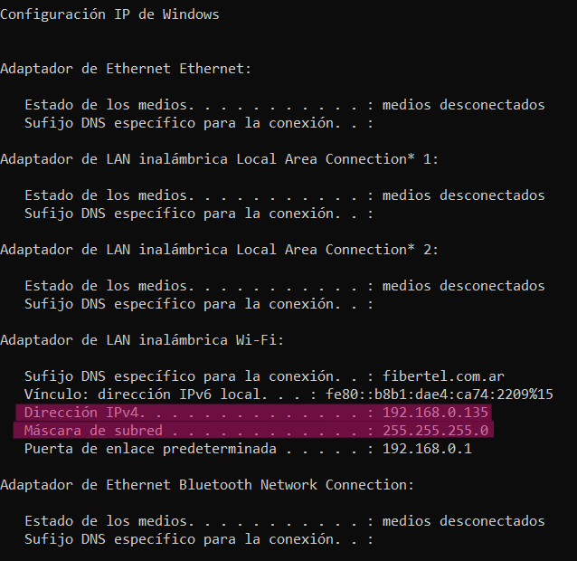

- **Dirección IP local:** 192.168.0.135

- **Máscara de subred:** 255.255.255.0

- **Dirección de broadcast de la red:** Para calcularla hacemos IP local OR (NOT) máscara de subred. Entonces como la máscara es 255.255.255.0, haciendo NOT queda 0.0.0.255 y haciendo el OR: (192.168.0.135) OR (0.0.0.255) = 192.168.0.255

- **Dirección MAC de broadcast:** FF:FF:FF:FF:FF:FF

### Consigna 2

*Abran Wireshark en la interfaz Wi-Fi y capturen al menos 2 minutos.*

- **Captura:** Adjuntamos dos archivos de capturas de wireshark bajo los nombres "TP7-captura1.pcapng" y "TP7-captura2.pcapng" en la carpeta titulada "Capturas wireshark". A su vez, para mejor visualización en este informe, mostramos capturas de pantalla de algunos paquetes:

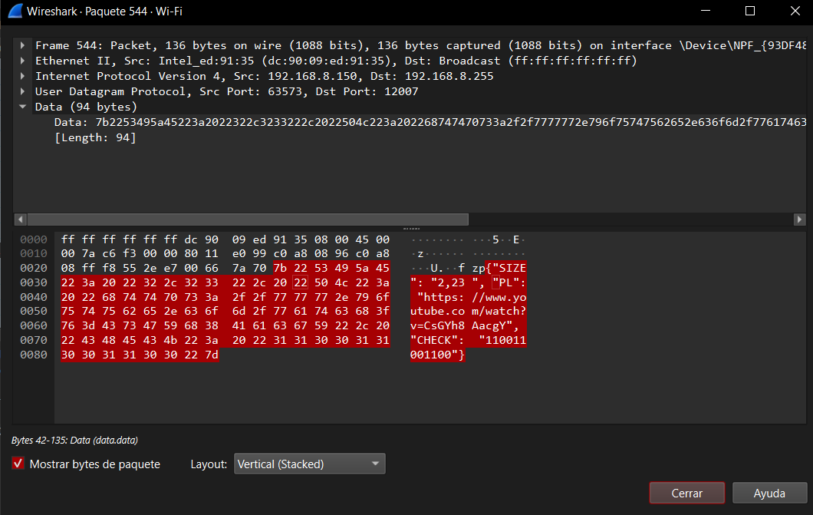

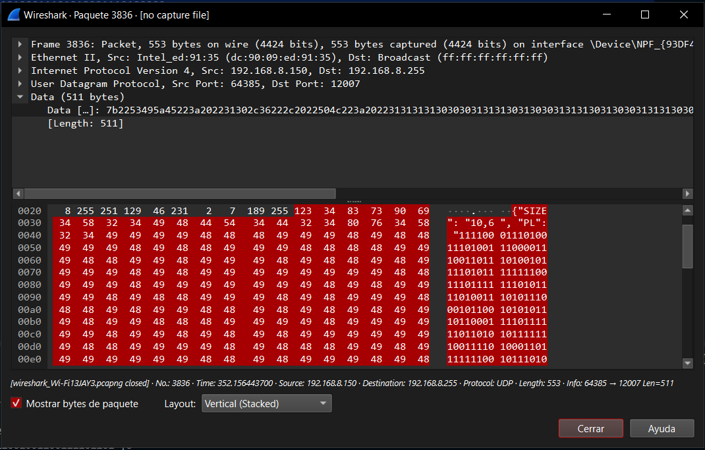

### Consigna 3

*Analicen la estructura del mensaje. ¿Qué formato tiene? ¿Qué campos contiene y qué creen que representa cada uno? Propongan cómo hay que interpretar los datos.*

- **Formato de la carga útil:** 
  El formato de la carga útil es explicitado en la consigna de este trabajo, donde se aclara que se trata de un JSON de forma {"SIZE": "FILAS, COLUMNAS", ???????}.

- **Análisis de los campos:**
  
  - `SIZE`: Este campo funciona para declarar el tamaño de la matriz, primero el número de filas y luego el número de columnas. Estos parámetros nos serán utiles en el momento de armar la matriz.
  
  - `PL`: Este campo contiene el payload de unos y ceros que, por más que están en código ASCII por lo cual cada número es en realidad 7 bits, para este caso representan bits que tendremos que decodificar con el archivo "decodificar_mensaje.py". 
  
  - `CHECK`: Este campo también es compuesto de unos y ceros que representan los bits de paridad, primero de las filas (de arriba a abajo) y luego de las columnas (de izquierda a derecha). 

- **Interpretación de los datos:** Al captar un paquete debemos armar la matriz de datos para poder utilizar el código "paridad.py" y ver los bits de paridad que devuelve para las filas y columnas. Entonces podremos detectar errores comparando con los bits de paridad otorgados en el campo CHECK.
  Para armar la matriz, primero se debe leer el campo SIZE para poder ordenar los bits de datos del campo PL. Tomamos en cuenta que se nos dice el número de filas N y de columnas M, pero para estas últimas se habla de 7 "bits" en cada una ya que se interpreta como un caracter ASCII. Entonces podemos copiar desde wireshark el campo PL, pegarlo en un archivo de texto y separar en N columnas de 7 bits debeiendo quedar M filas. 
  Aquí solo queda realizar la detección y corrección de errores como ya se mencionó antes; utilizamos "paridad.py" y comparamos sus resultados con los datos del campo CHECK. Al finalizar, habiendo cambiado los bits necesarios, pudimos reconstruir el mensaje original y decodificando en ASCII con "decodificar_mensaje.py" sabremos exactamente qué decía.

### Consigna 4

*Verifiquen la integridad del mensaje con el código de la sección 1: recalculen las paridades y compárenlas con las recibidas. Registren qué filas y qué columnas fallan (el síndrome).*

#### Análisis de Payload 1

- **Matriz analizada (SIZE [8, 7]):** El mensaje original de 392 bits se organizó en una matriz bidimensional de 8 filas por 49 columnas (representando 7 caracteres ASCII de 7 bits por cada fila).
- **Paridad de filas:** Al comparar contra los bits de control del campo CHECK, se detectaron discrepancias en las filas 4, 5 y 6 (el índice comienza desde 0).
- **Paridad de columnas** Existen diferencias en las columnas 8, 16 y 22.
- **Síndrome detectado:** El cruce de paridades indica errores simultáneos en las intersecciones de las **filas 4, 5 y 6** con las **columnas 8, 16 y 22**.

**Evidencia Payload 1:**

Mensaje con errores:
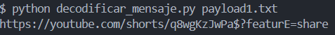
Matriz de paridad:
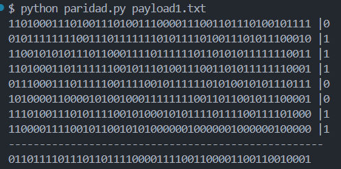Detección de errores:
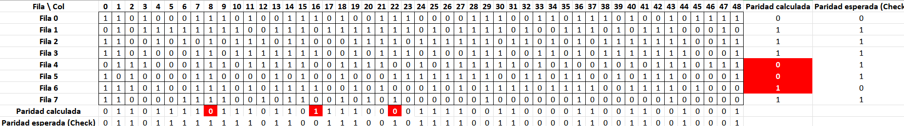

---

#### Análisis de Payload 2

- **Matriz analizada (SIZE [10, 42]):** El segundo mensaje, de 420 bits, fue estructurado en 10 filas por 42 columnas (6 caracteres ASCII por fila).
- **Paridad de filas (Calculada vs Recibida):** El cálculo local arrojó discrepancias con el control recibido en las filas 0, 4, 5 y 7.
- **Paridad de columnas (Calculada vs Recibida):** Se detectaron discrepancias en las columnas 2, 11, 17 y 24.
- **Síndrome detectado:** El análisis expone un síndrome de error múltiple que afecta las coordenadas donde se cruzan las **filas 0, 4, 5 y 7** y las **columnas 2, 11, 17 y 24**.

**Evidencia Payload 2:**
Mensaje con errores:
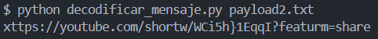Matriz de paridad:
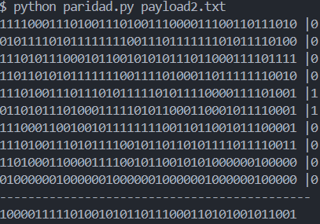Detección de errores:
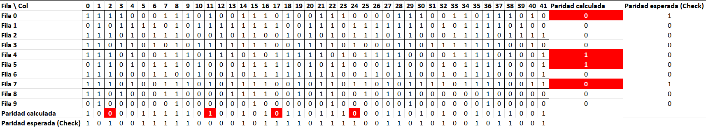

---

#### Análisis de Payload 3

- **Matriz analizada (SIZE [4, 28]):** El tercer mensaje consta de 112 bits, divididos en 4 filas por 28 columnas.
- **Paridad de filas:** Todas las filas presentan discrepancias matemáticas respecto al control (filas 0, 1, 2 y 3).
- **Paridad de columnas (Calculada vs Recibida):** Fallan las columnas 6, 10, 14 y 19.
- **Síndrome detectado:** Existe una ambigüedad masiva. El síndrome abarca la totalidad de las filas (**0, 1, 2 y 3**) y las columnas **6, 10, 14 y 19**. Al existir 4 filas y 4 columnas afectadas, la paridad bidimensional genera múltiples combinaciones posibles (24 combinaciones) que comparten el mismo síndrome, demostrando que en fallos múltiples se requiere del contexto semántico (tabla ASCII) para resolver la corrección.

**Evidencia Payload 3:**
Mensaje con errores:
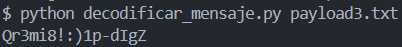Matriz de paridad:
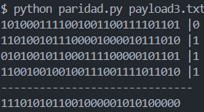Detección de errores:
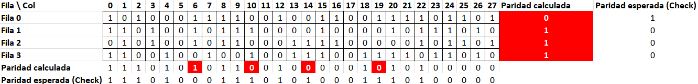

### Consigna 5

*Si hay errores, ubíquenlos y corríjanlos. Para cada bit corregido indiquen fila, columna, valor recibido y valor corregido.*

| **Fila** | **Columna** | **Valor Recibido** | **Valor Corregido** |
| -------- | ----------- | ------------------ | ------------------- |
| [Ej. 3]  | [Ej. 4]     | [Ej. 1]            | [Ej. 0]             |
| [...]    | [...]       | [...]              | [...]               |

*(Nota: Si analizaron más de un mensaje distinto, replicar esta tabla por cada mensaje)*

#### Payload 1 (matriz 8 × 49)
 
| **Fila** | **Columna** | **Valor Recibido** | **Valor Corregido** | **Carácter afectado** |
| -------- | ----------- | ------------------ | ------------------- | --------------------- |
| 4        | 8           | 1                  | 0                   | `w` → `W`             |
| 5        | 16          | 0                  | 1                   | `$` → `4`             |
| 6        | 22          | 0                  | 1                   | `E` → `e`             |

#### Payload 2 (matriz 10 × 42)
 
| **Fila** | **Columna** | **Valor Recibido** | **Valor Corregido** | **Carácter afectado** |
| -------- | ----------- | ------------------ | ------------------- | --------------------- |
| 0        | 2           | 1                  | 0                   | `x` → `h`             |
| 4        | 11          | 1                  | 0                   | `w` → `s`             |
| 5        | 17          | 1                  | 0                   | `}` → `u`             |
| 7        | 24          | 1                  | 0                   | `m` → `e`             |

#### Payload 3 (matriz 4 × 28)
 
| **Fila** | **Columna** | **Valor Recibido** | **Valor Corregido** | **Carácter afectado** |
| -------- | ----------- | ------------------ | ------------------- | --------------------- |
| 0        | 6           | 1                  | 0                   | `Q` → `P`             |
| 1        | 10          | 1                  | 0                   | `8` → `0`             |
| 2        | 14          | 1                  | 0                   | `p` → `0`             |
| 3        | 19          | 1                  | 0                   | `g` → `e`             |
 

### Consigna 6

*Construyan un archivo de texto en el formato de mensaje.txt con los datos ya corregidos y decodifíquenlo con decodificar_mensaje.py.*

- **Mensaje final decodificado:**
  
  > [Pegar aquí el texto final obtenido al ejecutar el script]

### Consigna 7 (Opcional)

*paridad.py calcula las paridades, pero no las compara con las recibidas.*

- **Modificación / Automatización:** [Pegar un fragmento de código o explicar brevemente cómo lograron que el script compare automáticamente y encuentre el síndrome]

## Reflexiones e investigación

### Reflexión 1

*¿Qué hubiera pasado si el mensaje tenía errores en dos bits de filas y columnas distintas? ¿Y si se dañaba un bit de los de control?*

- **Error en dos bits de datos:** [Desarrollar respuesta teórica]

- **Daño en un bit de control:** [Desarrollar respuesta teórica]

### Reflexión 2

*Si el mensaje es texto en castellano, muchas veces un error "se adivina" por contexto. ¿Sirve eso para una contraseña, un número de cuenta o una dirección web? ¿Qué aporta el código frente a "leer y adivinar"?*

- **Contexto en datos críticos:** [Desarrollar justificación]

- **Aporte del código (EDAC):** [Desarrollar justificación técnica]

### Reflexión 3

*¿Pudieron confirmar que su corrección es correcta? ¿Cómo?*

- **Método de confirmación:** [Explicar cómo validaron que la corrección fue exitosa más allá de que el texto final tuviera sentido]

### Reflexión 4

*Investigar y describir con el mayor detalle posible cómo funciona la técnica de corrección Hamming (7,4) y por qué es superior a la demostración didáctica que hicimos en este Laboratorio. Luego, aplicar la técnica sobre la carga útil obtenida.*

- **Funcionamiento del Código Hamming (7,4):** [Explicar la teoría de los bits de paridad superpuestos]

- **Superioridad técnica:** [Argumentar por qué es mejor que la paridad bidimensional]

- **Aplicación sobre la carga útil:** [Explicar o mostrar cómo estructurarían el payload del TP utilizando Hamming en lugar del método actual]
